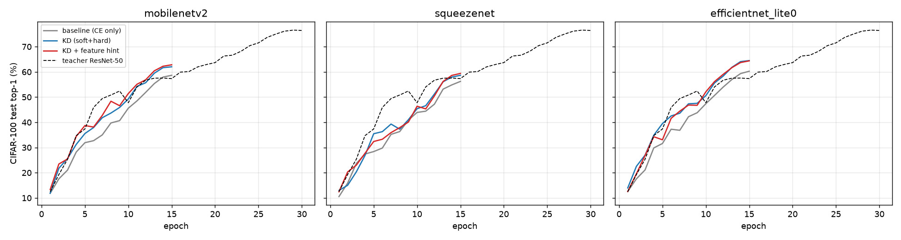
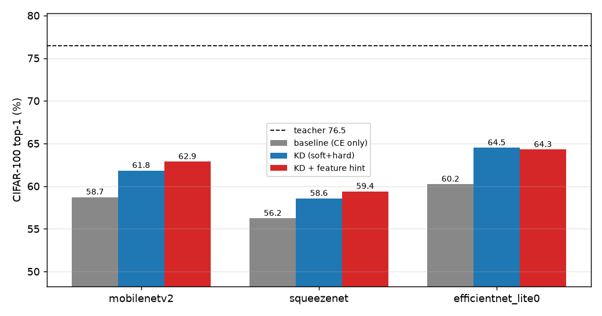
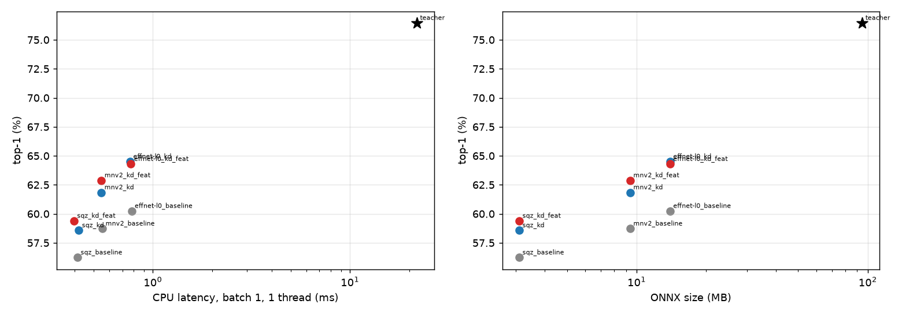
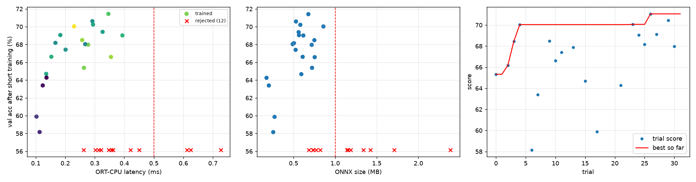
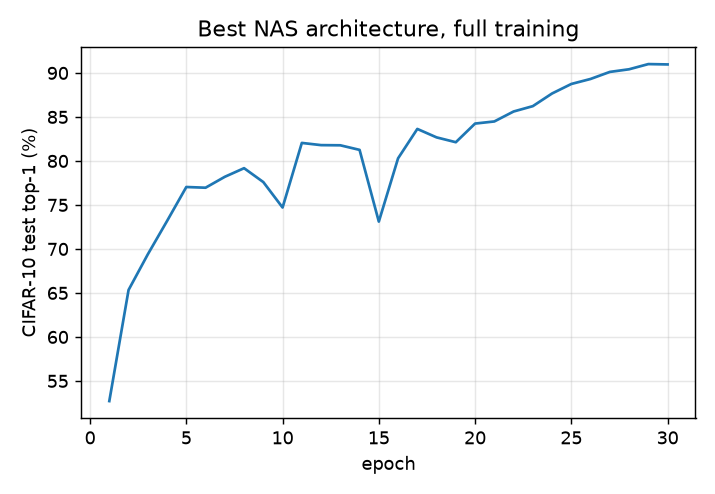

# Edge Computing Assignment 4 - Technical Report
Roll no: i230139 | Section: AI-B | Q1 knowledge distillation (CIFAR-100) | Q2 hardware-aware NAS (CIFAR-10)

## 1. Setup
- Hardware: HP Victus 15 (RTX 4050 6 GB for training, 11-core CPU). All latency / memory numbers are **ONNX Runtime CPU** (CPUExecutionProvider), batch 1, 1 thread unless stated.
- Data: CIFAR-100 (Q1) and CIFAR-10 (Q2), 32x32, standard train/test split, GPU-side flip + 4px random-crop augmentation, bf16 autocast.
- Because of the single-day deadline and one 6 GB GPU, training budgets are short (teacher 30 epochs, students 15 epochs, NAS final 30 epochs). Absolute accuracies are therefore lower than long-schedule literature values; comparisons between methods use identical budgets and seeds.

## 2. Q1 - Knowledge distillation
**Teacher.** ResNet-50 with a CIFAR stem (3x3 conv, no max-pool), 23.7 M params, trained from scratch: **76.45%** top-1 (ONNX/ORT).

**Students.** MobileNetV2, SqueezeNet (Fire modules + BN) and EfficientNet-Lite0 (MBConv, ReLU6, no SE), all re-implemented from scratch with strides adapted for 32x32 input.

**Distillation loss.** L = alpha * T^2 * KL(softmax(z_t/T) || softmax(z_s/T)) + (1-alpha) * CE(z_s, y), T = 4, alpha = 0.7. The T^2 factor keeps gradient magnitudes comparable across temperatures. **Feature distillation** adds beta * MSE between the L2-normalised channels of the student's 8x8 intermediate feature map (after a 1x1 conv+BN hint regressor) and the teacher's layer3 output (1024x8x8), beta = 1.

| Student | Params (M) | Baseline | KD (soft+hard) | KD + feature hint |
|---|---|---|---|---|
| mobilenetv2 | 2.35 | 58.72 | 61.84 (+3.12) | 62.88 (+4.16) |
| squeezenet | 0.78 | 56.23 | 58.57 (+2.34) | 59.39 (+3.16) |
| efficientnet_lite0 | 3.50 | 60.24 | 64.50 (+4.26) | 64.29 (+4.05) |

Notes: single seed per cell (seed 0), so differences below ~0.5 pt are within noise on a 10k test set. Where KD is not better than baseline, that is what was measured and is reported as such.

**Unified inference.** `inference.py` loads any exported `.onnx` through ONNX Runtime CPU and runs the same preprocessing for every model (`--model name --dataset --image/--n`).

**Benchmark (all models, ORT CPU).**

| model                       | architecture       | mode     |   input_res |   params_M |   MMACs |   onnx_size_MB |   top1_% |   lat_1thr_ms |   lat_4thr_ms |   throughput_img_s |   peak_mem_MB |
|:----------------------------|:-------------------|:---------|------------:|-----------:|--------:|---------------:|---------:|--------------:|--------------:|-------------------:|--------------:|
| teacher                     | resnet50 (teacher) | -        |          32 |      23.71 | 1298.01 |          94.74 |    76.45 |         21.88 |          6.47 |             196.63 |        293.42 |
| mobilenetv2_baseline        | mobilenetv2        | baseline |          32 |       2.35 |   24.58 |           9.38 |    58.72 |          0.55 |          0.25 |            6444.74 |         90.98 |
| mobilenetv2_kd              | mobilenetv2        | kd       |          32 |       2.35 |   24.58 |           9.38 |    61.84 |          0.55 |          0.25 |            6330.17 |         91.16 |
| mobilenetv2_kd_feat         | mobilenetv2        | kd_feat  |          32 |       2.35 |   24.58 |           9.38 |    62.88 |          0.55 |          0.27 |            6344.17 |         90.86 |
| squeezenet_baseline         | squeezenet         | baseline |          32 |       0.78 |   24.25 |           3.11 |    56.23 |          0.41 |          0.21 |            8894.97 |         73.68 |
| squeezenet_kd               | squeezenet         | kd       |          32 |       0.78 |   24.25 |           3.11 |    58.57 |          0.42 |          0.22 |            8234.67 |         73.79 |
| squeezenet_kd_feat          | squeezenet         | kd_feat  |          32 |       0.78 |   24.25 |           3.11 |    59.39 |          0.4  |          0.2  |            9283.89 |         73.74 |
| efficientnet_lite0_baseline | efficientnet_lite0 | baseline |          32 |       3.5  |   31.47 |          13.95 |    60.24 |          0.78 |          0.32 |            5024.05 |         99.23 |
| efficientnet_lite0_kd       | efficientnet_lite0 | kd       |          32 |       3.5  |   31.47 |          13.95 |    64.5  |          0.77 |          0.31 |            5109.21 |         99.36 |
| efficientnet_lite0_kd_feat  | efficientnet_lite0 | kd_feat  |          32 |       3.5  |   31.47 |          13.95 |    64.29 |          0.77 |          0.32 |            5095.66 |         99.41 |
| nas_final                   | nas_best           | -        |          32 |       0.17 |   15.07 |           0.68 |    90.99 |          0.34 |          0.15 |            9065.65 |         67.03 |

## 3. Q2 - Hardware-aware NAS (CIFAR-10)
- Search space (`nas_space.py`): input resolution {24,28,32}, stem width, global width multiplier {0.5..1.25}, head width, dropout and, for 4 stages, depth 1-3, kernel {3,5}, expansion {2,3,4,6} (MBConv blocks).
- Search: Optuna TPE, 32 trials, 289 s. Each candidate is exported to ONNX and **measured on CPU first** (latency, model size, peak process memory above the runtime baseline). Constraints: latency <= 0.5 ms, size <= 1.0 MB, extra memory <= 18 MB. A violating candidate is **rejected before training** (`TrialPruned`): **12 of 32** trials were rejected, 20 were trained (4 epochs on a 20k subset, scored on a held-out 5k validation split; score = val acc - 2*max(0, latency/max_latency - 0.5)).
- Best trial #26: val acc 71.44% (short proxy training), 167k params, 0.35 ms, 0.67 MB, extra mem 17.6 MB.
- Architecture: `{"res": 32, "stem": 32, "width": 1.0, "head": 512, "drop": 0.1, "d0": 2, "k0": 3, "e0": 2, "d1": 2, "k1": 5, "e1": 2, "d2": 3, "k2": 5, "e2": 3, "d3": 1, "k3": 5, "e3": 2}`
- Retrained 30 epochs on the full training set: **90.97%** CIFAR-10 test top-1 (torch), 90.99% via ORT; ONNX size 0.68 MB, latency 0.34 ms, peak memory 67 MB.

## 4. Honest limitations
- Short schedules and one seed per configuration; no confidence intervals.
- Latency numbers are on a desktop-class laptop CPU, not an actual edge device; ratios between models matter more than absolutes. ORT 1-thread latency for these tiny nets is close to the framework's per-call overhead.
- NAS proxy training (4 epochs) ranks candidates imperfectly; the search is small (32 trials).

## 5. Figures

*Fig 1: training curves of teacher and students*

*Fig 2: student accuracy, baseline vs KD vs KD+feature*

*Fig 3: accuracy vs ORT-CPU latency / size*

*Fig 4: NAS search history*

*Fig 5: retraining of the best NAS model*

## 6. Reproduction
See `README.md` (`bash run_all.sh`). Code was written with AI assistance (Claude Code); all numbers above come from running the included scripts.
